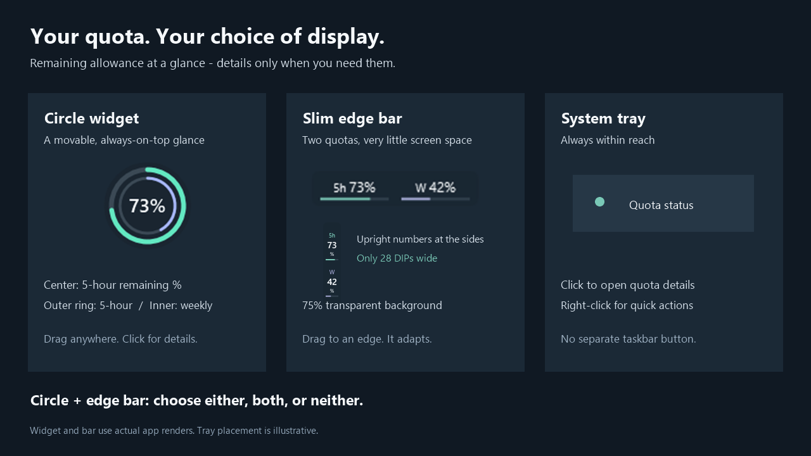
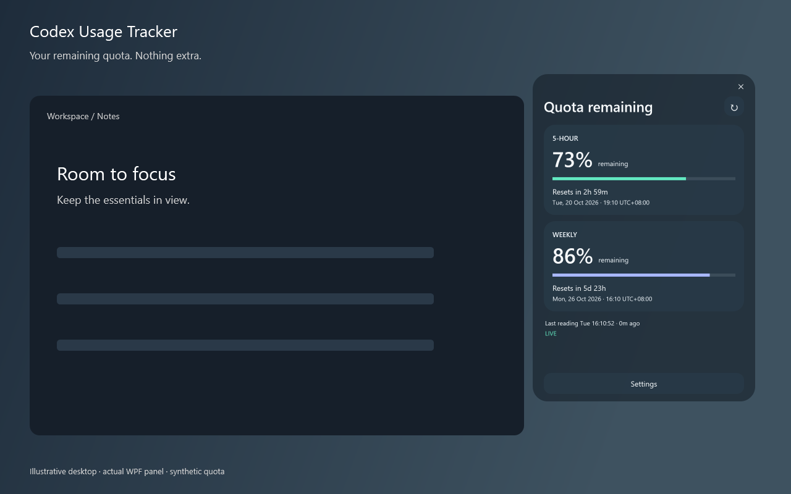

# Codex Usage Tracker

**Your remaining Codex quota, at a glance.** A minimal Windows companion with a movable circle, a slim edge bar, and a system tray menu. Click for reset times and quota details, then get back to work.

Windows 10/11 x64 · C# / .NET 8 / WPF · Uses your existing Codex sign-in

[Get started](#get-started) · [Choose your display](#choose-your-display) · [Quota details](#quota-details) · [Privacy](#privacy) · [Build from source](docs/DEVELOPMENT.md)

## Get started

1. Open [Windows builds](https://github.com/yx-le/Codex-Usage-Tracker/actions/workflows/build.yml), choose a successful run from **main**, and download **CodexUsageTracker-win-x64** under **Artifacts**. GitHub may require sign-in.
2. Extract the whole ZIP to a permanent folder and open **CodexUsageTracker.exe**. Keep its companion files together. The portable build includes the .NET runtime and runs without administrator access.
3. Find the circular tracker icon in the **system tray beside the clock**. Check Windows' overflow menu if it is hidden. Open **Settings → Display** to enable the circle, edge bar, or both.
4. Open Codex and sign in normally. The tracker finds Codex automatically; select your existing **codex.exe** in Settings if necessary.

**Fresh installs start in the system tray**, with both floating displays off. Existing preferences are preserved. By default, enabled displays appear only while Codex is running.

Enable **Automatically launch with Codex** in Settings for hands-off startup. A small watcher starts at Windows sign-in and opens the tracker when Codex runs. Settings save automatically.

## Choose your display

| Display | What it shows | Interaction |
| --- | --- | --- |
| **Circle widget** | 5-hour remaining percentage; outer 5-hour and inner weekly rings | Drag to move. Click for a panel centered beside the circle. |
| **Slim edge bar** | Both remaining percentages with teal and lavender indicators | Drag toward the top, left, or right edge to snap and adapt. Click for details. |
| **System tray** | Circular status icon and quick actions | Click for details; right-click to refresh, open Settings, toggle displays, or quit. |

Circle and edge bar have equal, independent controls. Enable either, both, or leave both off and use the tray. There is **no separate taskbar display**.

The edge bar is **28 DIPs thick** on the top or sides, with upright numbers on the sides. Its background is **75% transparent by default**. It overlays the desktop without reserving screen space.

### Panels follow the display you click

- **Circle:** centered vertically beside it, with an above/below fallback when neither side has room.
- **Left or right edge bar:** centered vertically beside the bar, toward the desktop.
- **Top edge bar:** centered horizontally below the bar.

Near monitor corners, the panel shifts to stay inside the work area and keep the indicator visible. Compact screens can use a smaller scrolling panel when needed.

## Quota details

The compact panel focuses on **quota remaining**, **reset countdowns**, **exact reset dates and local times**, and **reading freshness**. Hover over the status area for the data source.

**Percentages mean remaining allowance.** For example, **73% remaining means 27% used**. The 5-hour and weekly limits are separate, with independent reset times.

| Signal | Meaning |
| --- | --- |
| **Teal / lavender** | 5-hour / weekly quota |
| **Amber** | Low quota: 25% or less remaining by default |
| **Red** | Critical quota: 10% or less remaining by default; 0% is exhausted |
| **Dashed circle rings / STALE** | An older reading; check the last-update time |
| **LIVE / LOCAL** | App-server reading / local Codex fallback |
| **RESET DUE / N/A** | Waiting for a fresh reset reading / supported quota unavailable |

Warning thresholds are configurable. An exhausted quota keeps a visible warning outline or track. Missing data is never treated as zero usage or a confirmed refill.

**History charts and recording have been removed.** The tracker keeps the current quota reading in memory only.

## Everyday controls

- **Refresh:** automatic checks about every 60 seconds while Codex runs; additional checks when a reset is due. Manual refresh is available in the panel and tray menu.
- **Resource use:** disabled indicators are created only when needed, and unchanged UI does not rebind every second. Refresh timing stays the same.
- **Appearance:** Light, Dark, or System theme. Adjust transparency separately for the circle, edge bar, and panel. Positions and preferences are remembered.
- **Navigation:** click an indicator to toggle details. Settings opens within the same panel. Escape returns from Settings, then closes the panel.
- **Startup:** the watcher checks for Codex every two seconds. Quit stops the tracker for the current Codex session; a later Codex restart can launch it again. Disable automatic launch in Settings to stop the watcher.
- **Portable updates:** keep the extracted files together. Disable automatic launch before moving the folder, then re-enable it from the new location.

## Privacy

**No API key, browser cookies, tracker telemetry, or prompt/response storage.** Readings come from **Codex app-server → local Codex fallback → N/A** using your existing sign-in. Codex itself contacts its services for live quota.

Only preferences are saved in `%LOCALAPPDATA%\CodexUsageTracker`. The fallback reads quota fields from existing local Codex session records without retaining their conversation content. Old history databases from earlier tracker versions are no longer read or updated.

[Data sources and storage details](docs/DATA-AND-PRIVACY.md)

## Development

The desktop app has **90 automated tests**, including quota parsing, reset handling, preference recovery, and centered panel placement. Builds and visual checks run on Windows 11 x64. Windows 10 is targeted but has not been tested on a separate machine; physical multi-monitor testing is also limited.

A background `codex.exe` counts as running even when its main window is closed. Windows may suppress notification balloons. The tracker has no automatic updater.

[Build, test, and preview](docs/DEVELOPMENT.md) · [Architecture](docs/ARCHITECTURE.md) · [Rebuild illustrations](docs/render-readme.ps1)

Illustrations use actual app renders with synthetic quota. Desktop scenes and tray placement are illustrative; no private windows or account data are shown.

This is an independent utility, not an official OpenAI product.
