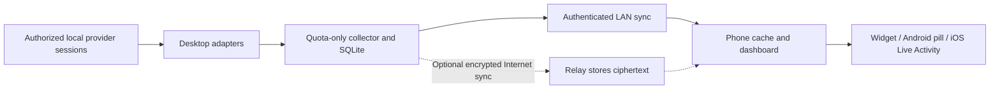

# AI Quota Monitor — mobile product plan

Planning draft · 18 October 2026. This is a proposed companion product, not an implemented mobile app. Platform and connector capabilities must be revalidated during implementation.

## Product purpose

Help people who use several AI subscriptions answer three questions without opening multiple apps: **What can I use now? When does it reset? Which account needs attention?**

The target user is an individual developer or heavy AI user with personal/work profiles and several tools. They may be using their computer while checking their phone. Their current problems are surprise limits, repeatedly opening usage pages, confusing different quota windows, and losing visibility when their computer is away or asleep.

The first release should be a focused quota monitor. Monitoring is the core value; the notch is one way to display it. The phone cannot assume access to other apps' private sessions or usage databases.

## What data is feasible

Track **provider + product + account/profile + quota bucket** independently. Codex, ChatGPT conversations, Claude Code, Claude chat, Gemini CLI, Gemini chat, and API projects are different products. Do not combine their budgets or present one as a proxy for another. A shared quota is grouped only when the provider confirms that relationship.

| Product | Evidence and proposed source | Initial promise |
| --- | --- | --- |
| Codex on a ChatGPT account | Desktop collector calls documented `account/rateLimits/read`; account/profile identity comes from the authorized local session. [OpenAI app-server docs](https://learn.chatgpt.com/docs/app-server). | First supported connector. Show each returned window by its actual duration and bucket identity. |
| General ChatGPT conversation limits | The app-server path above establishes Codex limit access. A general-purpose export for every ChatGPT feature has not been verified in this research. | Separate planned connector; unavailable until a supported source is validated. Do not label Codex quota as all ChatGPT usage. |
| Claude Code | Its documented status-line input can include five-hour/seven-day quota percentages and reset epochs. Availability depends on subscription/authentication and session state; fields can be absent. [Anthropic status-line docs](https://code.claude.com/docs/en/statusline). | Second connector, conditional on a successful prototype. Consume only allowlisted quota fields through a local adapter; preserve the user's existing status line. No transcript upload. |
| Gemini CLI / Code Assist | `/stats model` exposes quota information interactively. This establishes that the tool can show quota; it does not establish a stable background export API. [Gemini CLI commands](https://geminicli.com/docs/reference/commands/#stats). | Prototype the connector before promising automatic tracking. If no supported machine-readable route exists, mark unavailable or offer explicit manual entries. |
| Gemini consumer app | A supported consumer subscription-usage export was not established in this research. | Planned, not a launch guarantee. |
| API accounts/projects | API quota/spend has different units, permissions, and billing scope. For example, Gemini API limits apply per project. [Google API limits](https://ai.google.dev/gemini-api/docs/rate-limits). | Later, separate connector type. Never use API usage to estimate a consumer subscription's remaining quota. |

Multiple accounts means separately authorized profiles or paired collectors. Start with one provider account per collector/profile; support several collectors on the phone. Do not silently switch a CLI's active account to collect other profiles. Avoid duplicate counting when multiple devices report the same bucket.

## Android and iPhone display strategy

**Recommended first platform: Android**, if the notch experience is central to the product.

Android can offer a small optional pill near the camera cutout using an application overlay. Users must explicitly grant overlay permission. Overlays sit below critical system UI, and Android can change their visibility/position; this is not control of the hardware notch. [Android overlay reference](https://developer.android.com/reference/android/view/WindowManager.LayoutParams#TYPE_APPLICATION_OVERLAY), [permission management](https://developer.android.com/reference/android/provider/Settings#ACTION_MANAGE_OVERLAY_PERMISSION).

Default to the normal dashboard, home-screen widget, and notifications. Offer the notch pill as an opt-in display. The implementation spike must prove a legitimate foreground-service/background-update approach, battery behavior, and current Play Store policy fit. Do not use Accessibility services simply to bypass overlay restrictions. A denied permission must leave the rest of the app useful.

On **iPhone**, use SwiftUI widgets plus an optional ActivityKit Live Activity for a user-started monitoring session. Compatible devices can show it in the Dynamic Island. Apple's documentation describes an eight-hour activity lifetime; the system controls presentation. It is not an indefinite replacement for a Windows always-on-top widget. A feasibility spike must verify that this use case fits Apple's current guidelines and update budgets. [Apple Live Activities](https://developer.apple.com/documentation/activitykit/displaying-live-data-with-live-activities), [design guidance](https://developer.apple.com/design/human-interface-guidelines/live-activities).

Both platforms need cutout/safe-area handling, landscape behavior, accessibility scaling, quick hide/snooze, and a normal widget fallback. Never promise an overlay above every app, lock screen, video, or protected screen.

## Core experience and features

### 1. Overview

- One card per account/product; short aliases such as “Personal” and “Work,” with provider and product clearly named.
- Remaining percentage or the provider's actual unit; session/daily/weekly/model buckets only when reported.
- Countdown **and** exact reset date/time with timezone.
- Status: fresh, stale, offline, reconnect needed, manual, or unsupported. Always show last observed time.
- Pin favorites; optionally prioritize low quota. Never sum percentages from unrelated subscriptions.
- Tap a card for details. Pull to request refresh, showing whether the request reached the collector.

### 2. Account details

- All reported buckets, reset schedule, and source status.
- Seven-day straight-line history with genuine time spacing; break at resets and distinguish missing periods.
- Optional pace guidance when enough reliable observations exist. Forecasts are labeled estimates, not extra quota.
- Account-specific notifications and the last successful sync.

### 3. Compact notch/pill

- Collapsed example: `CX 48% · 2h` with a thin status accent. It represents one pinned account and a named limiting bucket.
- Expanded: provider/account label, the two most relevant buckets, reset times, and “Open details.”
- Show at most three favorites in the expanded view. Swiping/selecting changes focus; no constant automatic animation.
- Healthy colors stay muted; warning/critical use amber/red plus text or an icon. Do not rely on color alone.
- Adjustable size, position where supported, transparency, quiet hours, hide/snooze, and lock-screen alias privacy.
- Offline values retain their timestamp and stale indicator. A countdown reaching zero displays “Checking reset” until a fresh reading confirms the new quota.

### 4. Accounts and Settings

- Pair/unpair a collector by short-lived QR code; name accounts and choose which ones sync.
- Alert defaults: 25% and 10% remaining, deduplicated once per account/bucket/reset window. Optional confirmed-reset notification and snooze.
- Separate Display, Appearance, Alerts, and Connections/Data sections, carrying forward the desktop app's simpler navigation.
- Seven-day local retention by default, clear local data, encrypted export/import, and explicit device revocation. Explain whether removing an account also removes its history.

## Onboarding

1. Install the phone app; explain that it monitors quotas rather than chats.
2. Choose “Pair computer” and scan a one-time QR from the desktop collector.
3. Select authorized provider profiles, aliases, and favorite buckets.
4. Receive a test reading and see the source/time so pairing success is clear.
5. Choose notifications, home widget, and optionally the Android pill or iPhone session activity. Ask for each permission only when its feature is enabled.

Demo data is visibly labeled and never stored alongside real-account history. Missing connector support must be clear before the user spends time pairing it.

## Architecture and privacy

Reuse the existing .NET quota models, SQLite experience, and Codex adapter as the collector foundation. Keep the existing Windows app working without a phone or cloud service. Build Android in Kotlin/Jetpack Compose with Room, Keystore, native notifications, and overlay APIs. Add iPhone in SwiftUI/WidgetKit/ActivityKit once the data path is proven. Native shells are a proposal chosen for the platform-specific compact UI; no mobile framework migration is required for the current WPF app.

The collector emits a versioned quota-only envelope: collector ID, stable opaque account/profile ID, provider, product, bucket ID/model scope, observation time, units, remaining/used values when known, reset epoch, source status, sequence number, and schema version. Unknown values stay null. Do not include prompts, responses, project names, working directories, session transcripts, passwords, browser cookies, or provider bearer tokens.

Provider credentials remain in their authorized local profiles. Phone pairing credentials use OS secure storage. Pairing must establish authenticated keys and expire/reject replayed QR codes. LAN traffic is authenticated and encrypted. Any future relay requires end-to-end encryption, device revocation, replay protection, and a reviewed key-exchange design; it is not merely a public endpoint carrying local provider tokens. Push notifications carry an opaque update signal or encrypted/minimal payload, with user-controlled lock-screen content.

LAN-only mode works while the collector is reachable on the same network. Remote monitoring needs an explicitly enabled relay or user-managed secure network. If the computer sleeps, the phone keeps the last reading and marks it stale; it cannot discover new desktop usage until a collector is available. A phone-only future connector would require its own supported provider authorization and usage route.

Collect roughly once per minute while tools are active, backing off on failures/idle. Sync changed values and periodic heartbeats. Render countdowns locally from timestamps. The OS controls mobile background delivery, so “near real time while connected” is the target rather than guaranteed second-by-second updates. Settle exact cadences through battery measurements.

History is keyed by stable account/product/bucket identity; schema migrations are transactional, with versioned backups. Updates must not change the data directory or replace history with demo data. User clears must also clear recovery copies. Account removal/revocation invalidates future device sync. Automatic account rotation or pooling quotas to bypass provider limits is outside scope.

## Release sequence and completion gates

| Phase | Deliverable | Must pass before moving on |
| --- | --- | --- |
| 0: feasibility | Connector and platform prototypes; permissions/policy review | Real Codex data reaches a phone; Claude payload availability tested; Gemini route classified as supported/conditional/unavailable; Android pill survives basic device testing. |
| 1: useful Android alpha | Overview, pairing, multi-profile identity, Codex, reset times, history, alerts, normal widget | Offline/stale states, update/restart retention, account isolation, and pairing revocation work. A user can understand the next reset without opening a provider. |
| 2: broader beta | Claude connector if proven, optional Android pill, secure remote relay | No credential leakage; no missed critical state caused by fake freshness; acceptable measured battery impact on at least two manufacturers. |
| 3: iPhone and Gemini | iOS dashboard/widgets and eligible Live Activities; Gemini connector only if source spike passes | Real-device ActivityKit lifecycle verified; no unsupported promises; store-policy review and distribution readiness. |

Timeline is not committed until phase 0. Connector access and background restrictions are the main uncertainties, not drawing the dashboard. Cloud relay, push infrastructure, store distribution, device testing, and support are ongoing work even though no model inference API is needed for the monitor itself.

## Acceptance and success measures

- Two authorized accounts never share history or alerts accidentally; the same account seen on two computers is not counted twice.
- Readings match the provider's reported scope/value; unsupported quota shows unavailable rather than fabricated percentages.
- Freshness expires predictably after collector disconnection. Device clock differences and delayed/out-of-order events do not make old data appear new.
- Reset countdown and exact date match timezone changes, DST transitions, and midnight rollover.
- Update/reinstall-with-data-preserved and crash tests retain the configured history; backups recover a missing primary and clear does not resurrect it.
- Permission refusal, battery saver, reboot, airplane mode, screen rotation, display cutouts, and large accessibility text all retain a usable dashboard.
- No provider secrets or conversational content appear in database exports, relay logs, notifications, crash reports, or telemetry. Optional diagnostics require deliberate user action and redaction.
- Measure time to first valid reading, alert usefulness/duplicates, pairing completion, data freshness, and battery consumption in an opt-in pilot. Do not silently add analytics to measure them.

**Recommended decision:** start with Android + the existing Windows collector, real Codex monitoring, several paired profiles, and an optional quiet notch pill. Add Claude once its adapter passes validation; keep Gemini/consumer-chat support clearly conditional. Build the mobile product only after this plan and first visual flows are agreed.
